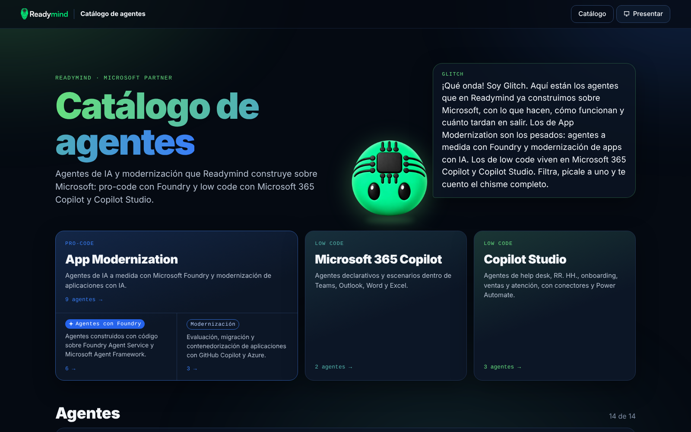
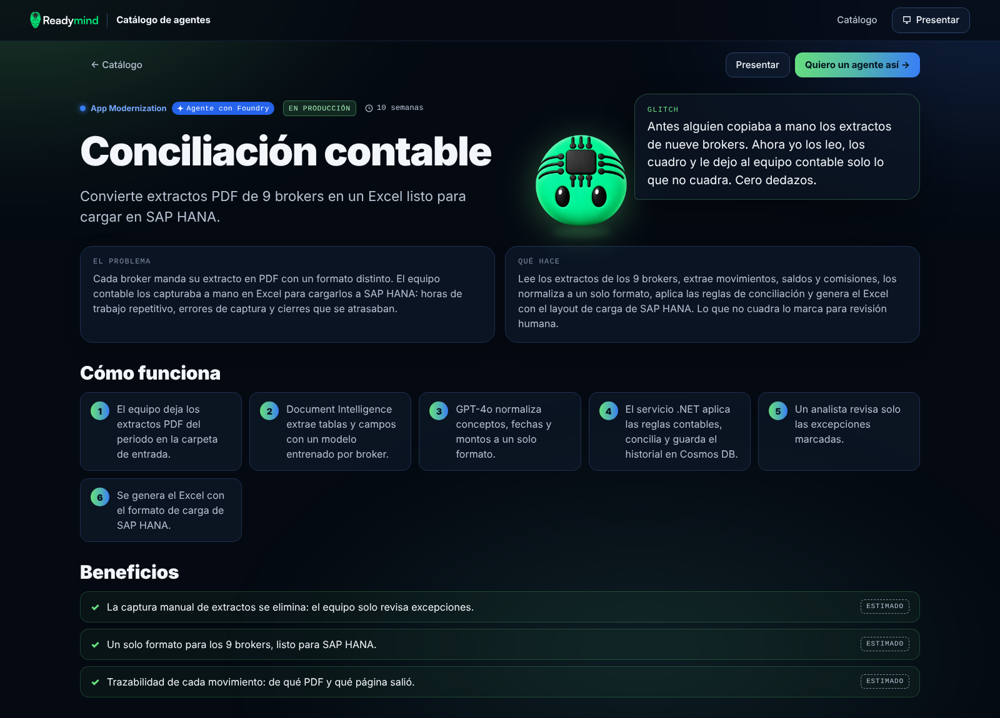
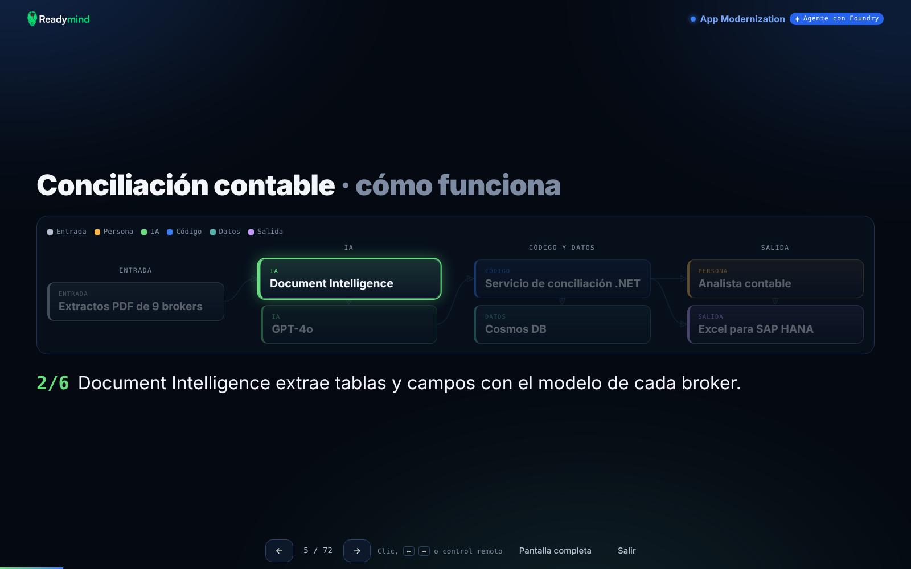
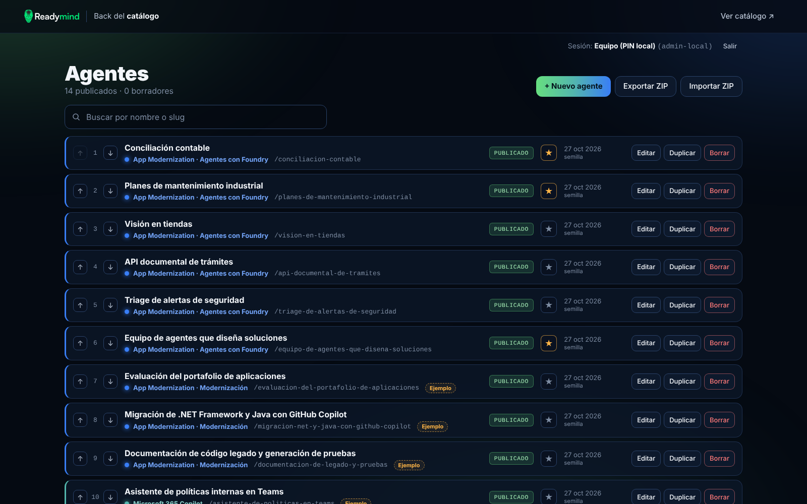
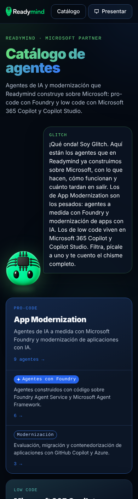

# Catálogo de agentes · Readymind

Web pública con los agentes de IA que construye Readymind sobre Microsoft, presentada por **Glitch**, más un back de administración para cargarlos en un formato estandarizado.

- **Catálogo público**: portada con Glitch, filtros que se reflejan en la URL, detalle con diagrama de arquitectura paso a paso, galería, QR y modo presentación para TV o tablet.
- **Back**: lista con estado, destacado, orden, duplicar y borrar; formulario validado con vista previa en vivo; carga segura de imágenes; exportar e importar todo en un ZIP.
- **Replicable**: un esquema único de ficha (`backend/app/schema.py`) y un solo archivo de marca (`catalogo.config.json`).



| | |
|---|---|
|  |  |
|  |  |

---

## Contenido

1. [Estructura](#estructura)
2. [Correr en local](#correr-en-local)
3. [Pruebas](#pruebas)
4. [Esquema de la ficha](#esquema-de-la-ficha)
5. [API](#api)
6. [Acceso y seguridad](#acceso-y-seguridad)
7. [Desplegar en Azure](#desplegar-en-azure)
8. [Copiar el catálogo a otro entorno](#copiar-el-catálogo-a-otro-entorno)
9. [Replicarlo para otro catálogo](#replicarlo-para-otro-catálogo)
10. [Reglas de contenido](#reglas-de-contenido)

---

## Estructura

```
catalogo.config.json     Marca: nombre, paleta, logos, textos de Glitch, familias, plataformas y contacto
Dockerfile               Un solo contenedor: compila el front y lo sirve FastAPI junto con el API
azure.yaml               azd (build remoto en Azure Container Registry)
infra/                   Bicep: Container Apps, Blob Storage, identidad administrada, App Insights, Entra ID
backend/
  app/schema.py          Esquema único de la ficha (Pydantic) ← fuente de verdad
  app/repo.py            Lógica del catálogo (agentes, orden, imágenes, caché pública, semilla)
  app/storage/           Almacenamiento con ETag: disco (local) o Azure Blob (producción)
  app/images.py          Validación y procesamiento de imágenes
  app/auth.py            Entra ID (Azure) o PIN (local)
  app/routes/            API público, back, exportar/importar
  seed/agentes.json      Semilla: se carga sola si el catálogo está vacío
  tests/                 Pruebas del API (pytest)
frontend/                React + Vite + TypeScript
  public/brand/          Glitch y logos de Readymind
  src/lib/types.ts       Espejo en TypeScript del esquema
  src/pages/             Portada, detalle, presentación y back (admin/)
e2e/                     Capturas y flujo del back con Playwright
```

## Correr en local

No necesitas nada de Azure: en local todo se guarda en disco, en `./data`.

**Requisitos:** Python 3.12 o superior y Node.js 20 o superior.

### Windows (cmd)

Terminal 1, el API:

```bat
cd backend
py -3.12 -m venv ..\.venv
..\.venv\Scripts\activate
pip install -r requirements-dev.txt
set ADMIN_PIN=1234
uvicorn --factory app.main:create_app --reload --port 8000
```

Terminal 2, el front con recarga en vivo:

```bat
cd frontend
npm install
npm run dev
```

### macOS / Linux

```bash
python3 -m venv .venv && . .venv/bin/activate
pip install -r backend/requirements-dev.txt
cd backend && ADMIN_PIN=1234 uvicorn --factory app.main:create_app --reload --port 8000
# en otra terminal
cd frontend && npm install && npm run dev
```

Después abre:

- Catálogo: <http://localhost:5173>
- Back: <http://localhost:5173/admin> (PIN `1234`)
- Documentación del API: <http://localhost:8000/api/docs> (solo en modo local)

La primera vez el catálogo está vacío y se carga la semilla (`backend/seed/agentes.json`). Para empezar de cero, borra la carpeta `data`.

**Como en producción:** ejecuta `npm run build` en `frontend/` y abre <http://localhost:8000>. FastAPI sirve el front compilado.

### Variables de entorno

| Variable | Para qué | Por defecto |
|---|---|---|
| `AUTH_MODE` | `pin` (local) o `entra` (Azure) | `pin` |
| `ADMIN_PIN` | PIN para entrar al back en modo `pin`. Si está vacío, el back no abre | — |
| `SESSION_SECRET` | Firma de la cookie del PIN. Si no se define, cambia en cada arranque | aleatorio |
| `ADMIN_ALLOWED_DOMAINS` | Dominios con acceso al back en modo `entra`, separados por coma (ej. `readymind.ms`) | todo el tenant |
| `ADMIN_ALLOWED_EMAILS` | Correos con acceso al back en modo `entra` | — |
| `DATA_DIR` | Carpeta de datos en local | `./data` |
| `AZURE_STORAGE_ACCOUNT_URL` | Si se define, usa Blob Storage con identidad administrada | — |
| `AZURE_STORAGE_CONTAINER` | Contenedor de blobs | `catalogo` |
| `SEED_ON_EMPTY` | Cargar la semilla si no hay agentes | `true` |
| `CACHE_SECONDS` | Caché del catálogo público en memoria | `30` |
| `APPLICATIONINSIGHTS_CONNECTION_STRING` | Telemetría en Application Insights | — |

## Pruebas

**API (pytest).** Cubren:
- acceso;
- validación;
- imágenes válidas e inválidas: falsas, de más de 8 MB, con EXIF, con path traversal;
- export/import;
- concurrencia con ETag;
- que lo no publicado no se vea.

```bat
cd backend
..\.venv\Scripts\activate
pytest
```

**Capturas y flujo del back (Playwright).** Requieren el servidor en <http://localhost:8000> con el front compilado y `ADMIN_PIN=1234`.

```bat
cd e2e
npm install
npx playwright install chromium
npm run capturas
npm run flujo
```

- `capturas.cjs` toma capturas en **390, 820, 1180 y 1600 px**. Falla si alguna página tiene scroll horizontal o errores de JavaScript.
- `flujo-admin.cjs` crea un agente y luego lo borra. Recorre el login, la validación, la carga de imagen, la vista previa, la publicación, el conflicto de edición y el paso a borrador. Úsalo solo en local.

## Esquema de la ficha

Está definido **una sola vez** en `backend/app/schema.py` (Pydantic):
- el API valida con ese modelo;
- el back valida en el navegador con el JSON Schema que exporta el modelo (`GET /api/admin/schema`);
- `frontend/src/lib/types.ts` es su espejo en TypeScript.

Si cambias el esquema, actualiza los dos archivos y esta tabla.

| Grupo | Campo | Tipo y reglas |
|---|---|---|
| **Identificación** | `slug` | minúsculas, números y guiones; único; es la URL `/agentes/{slug}` |
| | `nombre` | texto, 1–160 |
| | `familia` | id de una familia de `catalogo.config.json` |
| | `subfamilia` | obligatoria si la familia tiene subfamilias (`foundry` / `modernizacion`); vacía si no tiene |
| | `tagline` | la línea de valor, 1–200 |
| **Narrativa** | `glitch_dice` | la frase con la que Glitch presenta el agente, 1–400 |
| | `problema`, `que_hace` | texto, 1–2000 |
| | `pasos[]` | 1–12 pasos |
| **Público** | `para_quien[]` | roles |
| | `industrias[]` | usa siempre el mismo nombre para que el filtro funcione |
| **Valor** | `beneficios[]` | 1–12 de `{texto, tipo: "medido" \| "estimado"}` |
| **Técnica** | `plataforma` | una de `plataformas` en la config: Microsoft Foundry, GitHub Copilot, Microsoft 365 Copilot o Copilot Studio |
| | `tecnologias[]`, `integraciones[]` | listas de texto |
| | `requisitos_licencias`, `seguridad_gobierno` | texto |
| **IA** (Foundry) | `modelos[]` | lista de texto |
| | `tipo_agente` | `uno` \| `varios` (varios que colaboran) |
| | `conocimiento[]`, `herramientas[]`, `guardrails[]` | listas de texto |
| | `evaluacion_observabilidad` | texto |
| **Arquitectura** (opcional) | `arquitectura.componentes[]` | `{id, nombre, tipo, detalle}`, con `tipo` = `entrada` \| `ia` \| `codigo` \| `datos` \| `salida` \| `persona` \| `seguridad` |
| | `arquitectura.conexiones[]` | `[desde, hasta]`; los dos ids deben existir |
| | `arquitectura.pasos[]` | `{texto, componentes[]}` para el recorrido con clic |
| **Entrega** | `tiempo_implementacion` | texto (ej. "10 semanas") |
| | `madurez` | `demo` \| `piloto` \| `produccion` |
| | `demo_url` | `https://…` u omitido |
| **Imágenes** | `imagenes[]` | `{archivo, alt, etiqueta}`. El nombre de `archivo` lo genera el servidor. `alt` es obligatorio (mín. 3). `etiqueta` = `real` \| `anonimizada` \| `ia` \| `diagrama`. La primera imagen es la portada de la tarjeta |
| **Publicación** | `cta` | `{texto, url}` u omitido para usar el contacto general |
| | `estado` | `borrador` \| `publicado` |
| | `destacado` | sale primero en el catálogo |
| | `es_ejemplo` | muestra "Ejemplo: validar con el equipo"; se apaga al guardar desde el back |
| | `orden`, `creado`, `actualizado`, `actualizado_por`, `id` | los pone el sistema |

**Diagrama de arquitectura.** Se dibuja solo, a partir de los datos, en cuatro columnas:
1. Entrada.
2. IA (también los guardrails de `seguridad`).
3. Código y datos.
4. Salida.

Una `persona` va como entrada si nada le llega, y del lado de la salida si recibe algo.

## API

| Método y ruta | Acceso | Qué hace |
|---|---|---|
| `GET /api/config` | público | Marca, familias y etiquetas |
| `GET /api/agentes?familia=&sub=&plataforma=&industria=&madurez=&q=` | público | **Solo publicados**, sin `estado` ni `actualizado_por` |
| `GET /api/agentes/{slug}` | público | Detalle; 404 si no existe o es borrador |
| `GET /media/{archivo}` | público | Solo imágenes de agentes publicados |
| `GET /api/admin/sesion` · `POST /api/admin/login` · `POST /api/admin/logout` | — | Sesión (el login con PIN solo funciona en modo `pin`) |
| `GET /api/admin/schema` | equipo | JSON Schema de la ficha |
| `GET/POST /api/admin/agentes` | equipo | Lista completa y alta |
| `GET/PUT/DELETE /api/admin/agentes/{id}` | equipo | `PUT` y `DELETE` exigen `If-Match` con la versión. Si alguien guardó antes, responde 409 |
| `POST /api/admin/agentes/{id}/duplicar` | equipo | Copia como borrador con un slug nuevo |
| `POST /api/admin/orden` | equipo | `{ids, version}` con el nuevo orden |
| `POST /api/admin/imagenes` | equipo | Sube una imagen (multipart `archivo`) |
| `GET /api/admin/media/{archivo}` | equipo | Imágenes de borradores, para la vista previa |
| `GET /api/admin/export` · `POST /api/admin/import?modo=combinar\|reemplazar` | equipo | ZIP con `catalogo.json` e `imagenes/` |

## Acceso y seguridad

**Quién entra al back.**
- En Azure, con **Microsoft Entra ID**, mediante la autenticación integrada de Container Apps:
  - el registro de aplicación es *single-tenant*, así que solo entran cuentas del tenant de Readymind;
  - además se puede limitar con `ADMIN_ALLOWED_DOMAINS` o `ADMIN_ALLOWED_EMAILS`;
  - lo público queda abierto (`AllowAnonymous`), y el backend exige el encabezado `X-MS-CLIENT-PRINCIPAL` que pone la plataforma en `/api/admin/*`.
- En local, con `ADMIN_PIN`:
  - da una cookie HttpOnly, SameSite=Strict y firmada;
  - bloquea la IP 5 minutos después de 5 intentos fallidos.

En Azure el PIN está apagado (`AUTH_MODE=entra`): así no hay una contraseña compartida en producción.

**Contra CSRF.** Toda petición del back que cambie algo exige el encabezado `X-Requested-With: catalogo`, y no se habilita CORS.

**Lo público solo ve lo publicado.** El API público filtra por `estado` y quita los campos internos. Las imágenes de borradores no se sirven en `/media/`.

**Carga de archivos:**
- solo JPG, PNG o WebP, hasta 8 MB, con un tope de píxeles contra las bombas de descompresión;
- el contenido real se valida con Pillow: no se confía en la extensión ni en el Content-Type;
- se quitan los metadatos (EXIF, GPS, ICC) y se reduce a 1600 px como WebP, más una miniatura de 600 px;
- el nombre lo genera el servidor (`uuid4`), y las claves de almacenamiento solo aceptan `[a-f0-9]{32}.webp`, así que no hay path traversal.

**Varias personas editando.**
- Cada agente es un blob propio con su ETag. Si dos personas editan el mismo agente, la segunda recibe "Alguien más guardó cambios" y nada se pisa.
- El orden vive en `orden.json`, también con ETag.
- En Azure el Blob guarda versiones y retiene lo borrado durante 30 días.

**Encabezados.** Se envían CSP (sin scripts inline ni `eval`), `nosniff` y `Referrer-Policy`.

## Desplegar en Azure

**Qué se crea** (todo en Bicep, en `infra/`):
- Azure Container Apps;
- Azure Container Registry, para el build remoto (no necesitas Docker local);
- Blob Storage sin llaves (`allowSharedKeyAccess: false`);
- una identidad administrada con permisos de AcrPull y Storage Blob Data Contributor;
- Log Analytics y Application Insights;
- la autenticación integrada con Entra ID.

**Requisitos:** [Azure Developer CLI (azd)](https://aka.ms/azd-install) y [Azure CLI (az)](https://aka.ms/installazurecliwindows), con permiso para crear recursos y registros de aplicación.

### Primera vez (Windows cmd)

```bat
azd auth login
az login

azd env new catalogo-prod
azd env set AZURE_LOCATION eastus2
azd env set ADMIN_ALLOWED_DOMAINS readymind.ms

azd up
```

`azd up` crea la infraestructura, compila la imagen en Azure Container Registry y la despliega. Al terminar muestra la URL, y el catálogo público ya funciona.

### Si tu cuenta no puede asignar roles

`azd up` da roles a la identidad administrada de la app: **AcrPull** en el registro y **Storage Blob Data Contributor** en el Storage. Para eso hace falta el permiso `Microsoft.Authorization/roleAssignments/write`. Si no lo tienes, verás `does not have permission to perform action 'Microsoft.Authorization/roleAssignments/write'`.

Hay dos salidas:

**A. Pedir el permiso (lo más simple).** Pide a quien administre la suscripción el rol **Role Based Access Control Administrator** sobre el grupo de recursos `rg-<entorno>`. Puede limitarlo a esos dos roles. Luego repite `azd up`.

**B. Provisionar sin roles y que un admin los cree.** Tú corres:

```bat
azd env set ASIGNAR_ROLES false
azd provision
azd env get-values
```

De la salida de `azd env get-values` toma `AZURE_IDENTITY_PRINCIPAL_ID`, `AZURE_CONTAINER_REGISTRY_ID` y `AZURE_STORAGE_ACCOUNT_ID`. Con esos valores, alguien con permiso (Owner, User Access Administrator o RBAC Administrator) corre una sola vez:

```bat
az role assignment create --assignee-object-id <AZURE_IDENTITY_PRINCIPAL_ID> --assignee-principal-type ServicePrincipal --role "AcrPull" --scope <AZURE_CONTAINER_REGISTRY_ID>
az role assignment create --assignee-object-id <AZURE_IDENTITY_PRINCIPAL_ID> --assignee-principal-type ServicePrincipal --role "Storage Blob Data Contributor" --scope <AZURE_STORAGE_ACCOUNT_ID>
```

Después, tú:

```bat
azd deploy
```

En la opción B usa `azd provision` y luego `azd deploy`, no `azd up`: sin los roles, la app no puede bajar su imagen del registro ni leer el Storage. Los roles se crean una sola vez; los `azd provision` posteriores no los tocan mientras `ASIGNAR_ROLES` siga en `false`.

**Activar el acceso al back con Entra ID.** El registro de aplicación necesita la URL de la app, por eso se hace después del primer `azd up`:

```bat
azd env get-value ENTRA_REDIRECT_URI
REM Copia el valor; se ve así: https://ca-catalogo-xxxx.<región>.azurecontainerapps.io/.auth/login/aad/callback

az ad app create --display-name "Catalogo de agentes" --sign-in-audience AzureADMyOrg --enable-id-token-issuance true --web-redirect-uris <ENTRA_REDIRECT_URI> --query appId -o tsv
REM Copia el appId que regresa

az ad app credential reset --id <appId> --display-name catalogo --years 1 --query password -o tsv
REM Copia el secreto (solo se muestra una vez)

azd env set ENTRA_CLIENT_ID <appId>
azd env set ENTRA_CLIENT_SECRET <secreto>
azd provision
```

Listo: `https://<tu-app>/admin` pide tu cuenta de Microsoft.

**Opcional:** para limitar el acceso a personas concretas:
1. En el portal, abre Microsoft Entra ID → Aplicaciones empresariales → *Catalogo de agentes*.
2. Activa "¿Se requiere asignación?".
3. Asigna a las personas o al grupo del equipo.

### Después: solo código

```bat
azd deploy
```

Cambios en Bicep o en variables: `azd provision`. Si el secreto vence, renuévalo con `az ad app credential reset …`, ejecuta `azd env set ENTRA_CLIENT_SECRET …` y luego `azd provision`.

**Notas:**
- Al primer arranque en Azure, el catálogo vacío se llena con la semilla. Para empezar vacío, ejecuta `azd env set SEED_ON_EMPTY false` antes de `azd up`.
- `MIN_REPLICAS` (por defecto 1) evita el arranque en frío durante un evento. Con `azd env set MIN_REPLICAS 0` ahorras costo.

## Copiar el catálogo a otro entorno

1. En el back de origen, haz clic en **Exportar ZIP**. Baja `catalogo.json` con todas las fichas (también los borradores) y la carpeta `imagenes/`.
2. En el back de destino, usa **Importar ZIP**:
   - **Combinar:** agrega los nuevos y reemplaza los que tengan el mismo id.
   - **Reemplazar todo:** deja solo lo importado.

Antes de escribir nada se valida todo el ZIP: esquema, slugs únicos, imágenes presentes y nombres de archivo permitidos. Si algo falla, no se cambia nada.

## Replicarlo para otro catálogo

Para otra unidad, otro evento u otro cliente, el código no se toca:

1. **Marca:** edita `catalogo.config.json`.
   - `nombre`, `organizacion`, `descripcion`: textos generales.
   - `logo`, `mascota`, `favicon`: rutas a archivos en `frontend/public/`. Reemplaza los archivos de `frontend/public/brand/`.
   - `paleta`: colores. Se aplican como variables CSS.
   - `glitch`: lo que dice la mascota en la portada, en la presentación, en el cierre y cuando no hay resultados.
   - `familias`: con su `color`, su `grupo` y sus `subfamilias` (con id, nombre y etiqueta).
   - `plataformas`: las opciones válidas de la ficha.
   - `contacto`: correo, sitio y el botón de contacto por defecto.
2. **Agentes:** cárgalos desde el back, importa un ZIP o reemplaza `backend/seed/agentes.json`. La semilla solo se usa si el catálogo está vacío.
3. **Entorno nuevo:** `azd env new otro-catalogo` y luego `azd up`. Cada entorno de azd tiene sus propios recursos y su propio Blob.

Si cambias los ids de las familias o de las plataformas, las fichas existentes deben usar los nuevos. El back y la importación lo validan.

## Reglas de contenido

- **Sin nombres de clientes** en textos, imágenes ni ejemplos. Si una captura los tiene, anonimízala antes de subirla y etiquétala como "Captura anonimizada".
- **Honestidad:**
  - Una imagen generada con IA lleva "Imagen ilustrativa (IA)".
  - Una cifra no medida en un proyecto real va como "estimado".
- **Ejemplos:** las fichas inventadas llevan "Ejemplo: validar con el equipo" hasta que alguien las revisa y las guarda desde el back.
- **Tono de Glitch:** español de México, cercano, concreto y con algo de humor. Nunca de vendedor agresivo.
